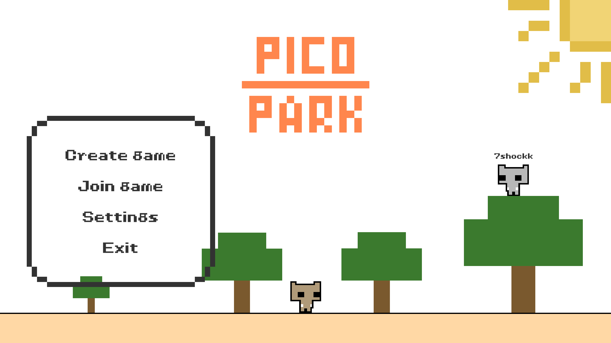
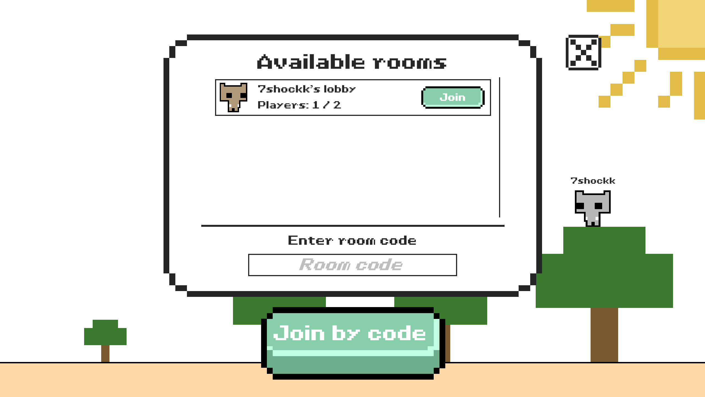
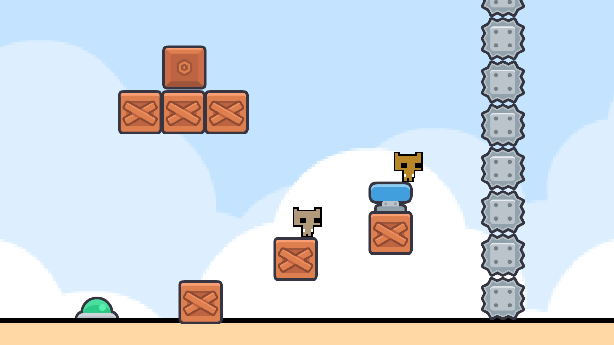

<h1 align="center">PICO PARK — Unity Fan Project</h1>

  
  
  

## About

An unofficial Unity learning project inspired by PICO PARK. Players work together across three levels, pushing walls, activating pressure plates, and carrying keys to the exit. The group advances once every player has entered the open door.

- Two-player local co-op on one keyboard.
- Online co-op using Photon PUN, with public rooms and private rooms joined by code.
- In-game pause menu, display and volume settings.
- English, Russian, Uzbek, and Karakalpak localization.

## Controls

| Action | Online | Local player 1 | Local player 2 |
| --- | --- | --- | --- |
| Move | A / D or Left / Right | A / D | Left / Right |
| Jump | Space | W | Up |
| Interact | E | E | Down |
| Drop key | Q | Q | Right Ctrl |
| Signal | F | F | Right Shift |
| Open or close the in-game menu | Esc | Esc | Esc |

## Run in Unity

1. Open the project with Unity **2022.3.15f1 LTS**.
2. Open `Assets/Scenes/Bootstrap.unity` and press Play.
3. Choose **Local Game** to play on one keyboard or use the online menu to create or join a room.

Local play does not require a Photon connection. Online play requires a configured Photon PUN app.

## Screenshots

## Credits

PICO PARK is the original game that inspired this project. This is an unofficial fan project. Third-party assets and packages remain subject to their respective licenses.
